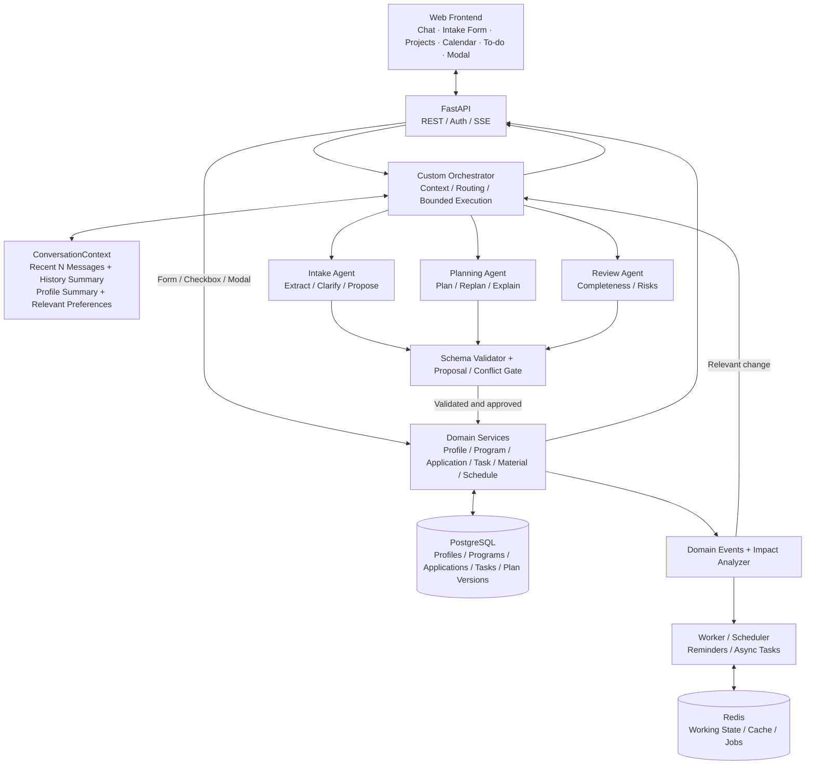

# ApplyOps V3：申请工作流 Agent 项目计划与旧版问题复盘

> **文档用途**：提供给 Codex 作为新版本的产品、架构、前端与测试实施依据。  
> **项目目标**：面向互联网公司的 **Agent 应用开发 / AI 后端实习**，完成一个有明确使用场景、真实持久化业务状态、可控 Agent 执行及可测试结果的应用。  
> **文档边界**：这是简明的产品与系统设计说明，不是完整数据库 DDL 或逐文件开发任务清单；遇到与当前仓库实现不一致的地方，先检查代码，再制定迁移方案。

## 1. 产品定位：不再做“搜官网的聊天机器人”

**新名称建议：ApplyOps — Stateful AI Application Workflow Copilot（智能申请工作流助手）。**

用户可以通过**聊天或表单**录入自己与目标项目的信息，建立结构化申请清单；系统据此生成申请日历和任务计划，通过**项目卡片 + 材料清单 + To-do** 跟踪申请进度。当用户完成任务、更改考试时间或更新项目要求时，后端持久化新状态，自动识别受影响的模块，必要时由 Planning Agent 生成新计划草稿并交由用户确认。

核心业务闭环：

```text
聊天 / 表单 /（后续）文档录入
   → 结构化信息提取、确认与保存
   → 申请项目列表与要求清单
   → 申请日历、任务及规划说明
   → 用户勾选完成 / 新增任务 / 更新信息
   → 后端更新唯一业务状态
   → 事件驱动地检查影响范围
   → 必要时生成计划新版本并请用户确认
```

**项目意义不是比通用 LLM 更擅长查官网**，而是把分散的申请信息和自然语言指令转化成**持续、可编辑、可追踪、可验证的业务工作流**。搜索官网最多是一个可选信息输入渠道，不是主产品能力。

**与普通 Agent Demo 的区别**：测试标准不仅是“聊天答得对不对”，更是“数据库状态是否正确变化、其他项目是否未被误改、依赖任务是否正确更新、用户拒绝提案后旧状态是否保持不变”。

---

## 2. 旧版 Opportunity Agent 的困难、根因与新版本的应对

这些是此前开发中真实遇到或已经暴露的典型失败模式，不应因为取消 RAG 就忽略。

| 旧问题 | 典型现象 / 根因 | V3 应对方式 |
|---|---|---|
| **数据不足、难以评价 RAG** | 缺少足够的 query–relevant-chunk 标注，无法合理调 chunk size、overlap、Top-K；项目知识库本身覆盖也不足 | **移除传统 RAG / pgvector / BM25 / reranker 的主链路**；改为任务/状态与字段级评测；不再为“技术栈完整”而保留 RAG。项目业务数据不足时，优先用户录入、表单编辑、可选文件导入，而不是假装全网数据库完整 |
| **Guard 正则误判路由** | 匹配到 GPA/TOEFL 等关键词后就跳过 LLM，误把含多个意图的请求当成单一画像更新 | Guard 只对**完整且高置信**的单一任务直接处理；局部匹配只输出 `extracted_facts` 和路由提示，仍交 Router/Orchestrator 判断其余意图 |
| **项目缩写消歧失败** | CSE/MCS/MSCS 等在不同学校可能不同，静态映射导致错误实体 | 建立 `canonical_program_id`、学校上下文、别名与申请季；歧义时明确让用户确认，不把缩写硬编码为唯一全称 |
| **正确官网被错误拒绝** | Tavily 找到了网页并取到正文，但校验要求标题出现静态展开的项目名，导致正确目录页/FAQ 被拒绝 | 官网搜索改为**可选导入能力**；若启用，先进行学校/项目实体识别，再综合域名、URL、标题、正文、父子链接判断相关性；允许 `UNCERTAIN`，不以标题字符串为唯一硬门槛 |
| **LLM 从网页提取错误字段** | 页面有不同项目、不同学位、不同申请季的 GRE/deadline，模型抽错或无依据补全 | 用户输入/文件/可选网页均采用 **Schema-guided Extraction + evidence + 字段级验证**；明确所属项目、申请季、证据片段、来源及 `verified / user_provided / unknown`；不以缺失信息推断 `false` |
| **官网信息跨多页面** | 目录页、项目页、FAQ、培养方案分散；单页提取不全 | V3 主流程不依赖自动官网覆盖；后续若做网页导入，允许多个页面为同一 `program_id` 提供不同字段的证据，不要求单页全覆盖 |
| **经常“部分完成/未核实”** | 搜到信息后被错误匹配拒绝，或校验与提取失败被混为一谈 | 统一失败原因：`entity_ambiguous` / `missing_field` / `evidence_missing` / `invalid_value` / `conflicting_value` / `tool_failed`；按缺失项补充或请求用户输入，不在失败时捏造结论 |
| **LLM 多轮上下文丢失** | 每次 `invoke` 可能只传当前用户问题；上一轮问 A/B，下一轮输入 A 无法理解 | Orchestrator 每轮构建 `ConversationContext`：最近 N 条原文、较早历史摘要、相关画像摘要和偏好；**重要的冲突确认走前端弹窗和审批 API，不通过聊天输入 A/B** |
| **模块职责与数据写入混杂** | 容易出现 Router 既执行又生成答案、不同 Agent 持有不同业务状态、循环重试不受控 | Custom Python Orchestrator 管控制流程；Agent 产出结构化结果/提案；Domain Services 统一做事务写入；设置有界执行、状态校验与失败处理 |

**需要保留的好设计**：规则优先 + LLM 补充抽取、结构化 JSON、原文 `evidence`、Normalizer（仅标准化可统一的分数/排名/日期等）、Validator、冲突审批、Conversation State / Profile / Preference 的严格区分、有限重试与可观测性。

---

## 3. V3 的三个 Agent：职责与边界

### 3.1 Intake Agent：录入、提问与结构化提取

**输入**：聊天、用户填写的表单；后续可扩展申请要求 PDF、邮件或官网导入。  
**目标**：建立并维护目标项目列表与 User Profile，缺什么问什么，但允许不完整草稿。

- **User Profile**：专业、GPA、语言/GRE 成绩、考试计划、个人经历、目标与稳定偏好。
- **Program Catalog**：学校、标准项目名、申请季、申请截止日期、录取要求、语言要求、费用、培养方案、课程、官网链接等。
- **Application**：某用户是否申请该项目、当前申请状态、优先级等。
- **固定字段 + 自然语言字段**并存：日期、费用、分数、排名可正规化；培养方案、课程特色等保留原义，不强行变成有限枚举值。
- 支持**多轮澄清**与结构化草稿；未知字段保持 `null/UNKNOWN`，不能臆造。

**提取链路**：

```text
User full message
   ↓
FastExtractor（确定性字段：分数、日期、金额、排名等）
   ↓
LLM Structured Extractor（输入：完整原文 + 规则已提取 facts）
   ↓
FactCandidate JSON（field / value / evidence / source / confidence / operation）
   ↓
Merge & Dedup → Normalizer（只对适合字段）→ Validator
   ↓
查已有 DB 状态 → ChangeProposal / Conflict
   ↓
用户确认（如需）→ Domain Service 写库
```

注意：**不要把规则匹配的原文删除后才交给 LLM**；LLM 要同时看到完整原文和已识别 facts。`evidence` 必须回指用户输入或上传文档的真实片段，不能编造。

### 3.2 Planning Agent：日程、依赖关系与重规划

**输入**：已保存的 Profile、Applications、Requirements、Tasks、用户可用时间和当前 Active Plan。**不应只消费 Intake 上次自然语言回复**。

- 输出按月/周/日展示的计划：各项目截止日期、SOP/推荐信/成绩单准备任务、语言考试时间、签证安排等。
- 区分**确切日期**、**用户设定日期**和**建议时间窗口**：未确认的签证预约不能显示成真实预约。
- **规则 Schedule Engine** 处理时间计算、截止日期、依赖与硬约束、日程冲突。
- **LLM Planning** 负责任务拆分、优先级建议、计划解释和用户要求的自然语言规划文章。
- 计划必须有版本：`Plan V1 active → V2 draft → 用户确认 → V2 active`；拒绝新计划不得覆盖旧计划。

### 3.3 Review Agent：申请状态、缺失材料与风险检查

**输入**：Application、ApplicationRequirements、Materials、Tasks、日程与 Profile 的当前状态。

- 维护**逻辑上的完整性和风险审查**，前端负责展示项目卡片。
- 每个项目显示材料 Checklist：SOP、推荐信数量与状态、CV、成绩单、语言成绩、截止日期及其他特定要求。
- 支持用户自定义 To-do，例如“SOP 第二轮修改”“联系推荐人”“参加考试”。
- **Task 完成 ≠ Requirement 已满足**：完成“SOP 修改”不代表已上传最终 SOP；参加 TOEFL 考试不代表成绩已出。
- 返回缺失要求、潜在风险和建议行动；由 **Task / Material / Application Service** 更新业务状态，而不是 Review Agent 自己随意写库。

### 3.4 三个 Agent 的输出契约（保持简单）

```python
class IntakeResult(BaseModel):
    profile_fact_candidates: list
    program_candidates: list
    change_proposals: list
    missing_fields: list[str]
    clarification_questions: list[str]

class PlanningResult(BaseModel):
    schedule_draft: list
    task_proposals: list
    dependencies: list
    conflicts: list
    changes_from_active_plan: list
    planning_narrative: str

class ReviewResult(BaseModel):
    application_id: str
    missing_requirements: list
    detected_risks: list
    recommended_actions: list
    completeness_status: str
```

三者可以在同一后端进程作为 Jiuwen Agent 逻辑模块运行；**第一版不必强制拆三个 A2A 微服务**。

---

## 4. Agent 协作与后端分工

### 4.1 关键架构原则

- **PostgreSQL 是 Single Source of Truth**：Agent 不各自维护不同的项目/画像/待办状态。
- **Orchestrator = 确定性 Python 控制器**：装配 ConversationContext、意图路由、调用 Agent、超时/有限重试、结构化结果收集、校验、结果组织，不做无限 ReAct loop。
- **Agent = 语义层**：理解自然语言、补全提取、规划建议、审查风险；生成 `Result` / `ChangeProposal`，不直接写核心业务表。
- **Domain Services = 业务写入层**：Profile / Program / Application / Task / Material / Schedule Service 处理验证、事务、版本、权限、幂等和状态变化。
- **事件驱动联动**：`TaskCompleted`、`DeadlineChanged`、`ProgramAdded`、`ExamDateChanged`、`MaterialUpdated`、`ProfileUpdated` 等事件触发 Impact Analyzer 判断受影响范围。
- **小变化自动同步；重大计划调整需审批**。计划由 Planning Agent 生成草稿，用户接受后才成为 Active。

### 4.2 交互关系（推荐架构图）



### 4.3 最重要的交互：用户勾选 To-do 后

```text
用户在 Review/To-do 中勾选“完成 SOP 第二轮修改”
  → 前端调用 Task Service API（不必须经过 LLM）
  → PostgreSQL 中 task.status = DONE
  → 申请卡片和 To-do 自动刷新
  → 发出 TaskCompleted（含唯一事件 ID）
  → Impact Analyzer 判断：是否影响材料要求 / Plan
  → 如果只影响显示：自动同步，无需重复问用户
  → 如果影响实际日程：Planning Agent 生成 V2 Draft
  → 弹窗展示 V1/V2 差异，用户确认后激活 V2
```

**不要把每个 To-do 勾选都当成“更新用户画像”**。只有真的改变稳定用户事实（例如取得了新 TOEFL 成绩）才更新 Profile；修改 SOP、提交推荐信主要更新 Task / Material / Application 状态。

### 4.4 后端要承担哪些真实工程能力

| 后端职责 | 具体实现目标 |
|---|---|
| API/认证 | FastAPI、Pydantic、身份校验、用户数据隔离、REST + SSE |
| 持久化 | PostgreSQL、SQLAlchemy、Alembic；用户/项目/申请/材料/任务/计划关系模型 |
| 状态一致性 | 事务、乐观锁/version、幂等请求、变更审计、拒绝提案不修改现有记录 |
| 异步工作 | Redis + Worker/Scheduler：文件解析（后续）、通知、定时检查、任务重试 |
| 业务事件 | Impact Analyzer 决定哪些事件触发 Review/Planning，避免每次更新都全量重规划 |
| 多轮对话 | ConversationContext：最近 N 条原文 + 较早历史摘要 + 相关 Profile/Preference；每次 invoke 显式注入 |
| 写入审批 | Profile 冲突弹窗显示新旧值、证据；计划版本差异弹窗；重大更新经用户确认 |
| 可观测性 | OTel 记录 Agent/工具耗时、错误、重试、任务状态变化；不在日志中随意输出敏感材料原文 |

### 4.5 Conversation State、Profile、Preference 的区别

```python
class ConversationContext(BaseModel):
    recent_messages: list[Message]   # 最近 N 条保留原文
    summary: str | None              # 更早历史的滚动摘要
    profile_summary: dict            # 从 Profile Service 读
    relevant_preferences: list       # 从 Preference Memory 读
```

- `Conversation State`：当前对话语境与摘要，用于解决“那 A 呢？”这类指代；与当前会话关联。
- `Profile`：GPA、语言成绩、研究经历等稳定结构化用户事实。
- `Preference Memory`：跨会话偏好，如地区、预算、项目类型优先级；不是把所有聊天内容复制进长期记忆。
- **重要业务确认不再要求用户下一轮打 A/B**：前端选项弹窗直接调用审批 API，旧值/新值选择后执行一次事务性更新。

---

## 5. 前端交互需求：保留之前设计的这些界面

> **交给 Codex 的明确要求：这些是真实可交互、与 API/数据库绑定的页面，不是静态插图。** UI 风格采用清爽的申请工作台：卡片式布局、状态标签、简洁的日历和进度条；优先实现桌面端，适配常见移动端宽度。

### 界面 A：总览 Dashboard（申请工作台）

- 顶部概览：目标项目数量、临近截止日期、待确认变更、待完成任务。
- 下方：即将到来的事件、风险提醒、最近变更、各项目进度。
- 可点击项目进入申请卡片，可从风险提示直接定位对应任务。

```text
┌──────────────────── ApplyOps Dashboard ─────────────────────┐
│  目标项目 12     待完成任务 18    临近截止 3    待确认 2      │
├─────────────────────┬─────────────────────────────────────┤
│ 即将到来的日程       │ 近期变化与需要处理的问题              │
│ · 语言考试           │ · 项目 B 截止日期待确认               │
│ · SOP 定稿           │ · 3 封推荐信中已提交 2 封             │
├─────────────────────┴─────────────────────────────────────┤
│  我的项目  [项目卡 A] [项目卡 B] [项目卡 C] ...             │
└───────────────────────────────────────────────────────────┘
```

### 界面 B：Intake（聊天 + 表单双模式）

- 左边自然语言聊天，右边结构化项目编辑表单或数据预览（窄屏改为切换视图）。
- 固定字段：学校、项目名、申请季、截止日期、录取/GRE 要求、语言要求、费用、培养方案、课程、官网链接。
- 自动提取字段显示**来源和是否已确认**；未输入的显示“待补充”，允许存草稿。
- 新增、编辑后保存到项目清单；同校不同项目必须区分实体。

```text
┌────────────────── Intake Workspace ─────────────────────────┐
│ [聊天录入] [表单录入]                  项目草稿 / 字段预览   │
│ 用户：想申 X 学校 Y 项目……            学校：X              │
│ Agent：还缺申请季，想补充吗？          项目：Y              │
│                                       截止日期：待补充       │
│                                       费用：待补充           │
│                                       [保存草稿] [确认更新]   │
└────────────────────────────────────────────────────────────┘
```

### 界面 C：Planning（日历 + 计划文章 + 新旧版本比较）

- **日历视图**：月/周切换。不同类型标识：项目截止日期、语言考试、SOP/材料准备、预计签证时间窗口、用户自定义任务。
- **任务侧栏**：显示选中日期的事件、关联项目、优先级、状态和修改入口。
- **规划说明**：按钮触发 Planning Agent 生成自然语言规划文章，必须引用当前已保存日程，不编造日期。
- **重规划对话框**：重要变化触发时展示当前计划 V1 与草稿 V2 的新增/删除/日期修改清单，提供“采用新计划 / 保留原计划”。

```text
┌────────────────── Planning Calendar ───────────────────────┐
│ [‹] 2026 年 11 月 [›]       [月] [周]  [生成规划说明]        │
│ 日       一       二       三       四       五       六      │
│ ... [语言考试] ... [SOP 定稿] ... [材料核对] ...             │
├───────────────────────────────┬───────────────────────────┤
│ 当日事件 / 任务详情             │ AI 申请规划说明            │
│ · 关联项目、日期、完成状态      │ · 关键期限                 │
│ · 编辑、标记完成               │ · 本周安排与风险           │
└───────────────────────────────┴───────────────────────────┘

重要变更：Plan V1 → Plan V2 草稿
[旧计划日期]  → [建议新日期]     [保留 V1] [采用 V2]
```

上图仅是布局示意，日期不代表任何真实学校截止日期；`estimated visa window` 不得伪装成已确认签证预约。

### 界面 D：Review（项目申请卡片 + 进度条 + To-do）

**必须保留此前交互卡片的设计**：一张项目卡显示材料完成计数、绿色进度条、可勾选清单、额外 To-do、截止日期与当前申请状态。

```text
┌──────────────────── 申请项目卡 ──────────────────────────────┐
│ 项目：X University · MS Example              [准备中]       │
│ 申请季：Fall 2027                 截止：待核实               │
│ 材料准备进度：2 / 5    [████████░░░░░░░░]                   │
│                                                            │
│ [✓] CV                                                     │
│ [ ] SOP 最终版                                              │
│ [✓] 成绩单                                                  │
│ [ ] 推荐信：已提交 2 / 要求 3                               │
│ [ ] 语言成绩                                                │
│                                                            │
│ 自定义 To-do                                               │
│ [ ] 完成 SOP 第二轮修改                                     │
│ [ ] 联系第三位推荐人                                        │
│ [+ 添加待办]                             [检查申请完整性]    │
└────────────────────────────────────────────────────────────┘
```

**行为约束**：

- 勾选 To-do 必须调用后端 API 并持久化；刷新页面状态不能丢。
- 材料 `Requirement` 与用户 `Task` 是不同实体；完成修改 To-do **不自动**把最终 SOP Requirement 标为已完成。
- 推荐信支持 `required_count`、已邀请、已提交等数量状态。
- 卡片进度计数仅统计明确的必需材料，不把可选 To-do 混进 denominator；每项最终完成必须可追溯到真实状态。
- 项目、任务状态变化后卡片自动更新；真正影响规划时显示重规划建议。

### 界面 E：冲突确认弹窗（代替聊天 A/B）

```text
┌──────── 检测到用户信息冲突 ────────┐
│ TOEFL                            │
│ 旧信息：107                       │
│ 新信息：110                       │
│ 新信息来源：“我刚考到 110”         │
│ [保留旧信息 107] [使用新信息 110] │
└──────────────────────────────────┘
```

点击任意选择：前端提交 `conflict_id + choice`，后端校验用户权限、读取最新版本，在一个事务中写入或保留，记录操作日志；禁止仅靠 LLM 文本回复去改变数据库。

### 界面 F：全局 To-do 与进度

- 聚合所有申请项目与个人任务（如语言考试、签证准备），按日期、项目、完成状态筛选。
- 支持新增、编辑、完成、取消、关联某个 Application、设置提醒。
- **同一个任务只保存一个真实状态**，在全局 To-do、项目卡和日历展示时都来自同一记录。

---

## 6. 计划状态流转、避免重复更新

```text
User checked Task
   → TaskService update（事务，幂等）
   → PostgreSQL commit
   → emit TaskCompleted(event_id, application_id, task_id)
   → UI：To-do + Project Card 立即反映最新状态
   → Impact Analyzer：查找受影响的 Requirement / Schedule
   → 小变化：仅同步状态
   → 重大变化：Planning Agent 产出 PlanDraft V2
   → 前端展示与 V1 的差异
   → 用户确认后 PlanService 激活 V2，否则保持 V1
```

- 以 **数据库业务实体 + Domain Event** 连接 Agent，而非 Agent 相互直接覆盖状态。
- 事件消费者必须支持去重/幂等；Worker 重试不能重复创建任务。
- 为 Plan 设置 `draft`、`active`、`rejected` 状态和版本号；避免因为 `PlanActivated` 等事件造成无休止重规划。
- Review 检查是读取与分析行为；最终写入必须走 Domain Service。

---

## 7. 测试数据集：格式与评测指标

**不需要等积累几百个真实学校或完整文档才能测试**。先用小规模、可验证、可复现的样本测试业务链路，并逐步扩展。建议测试分层，初期 30–50 条端到端场景就可以开始回归测试；不应将小样本结果包装成大规模泛化结论。

### 7.1 Intake Extraction Gold Dataset（JSONL）

每行包含原始用户输入和人工核对的结构化期望输出；Profile、Program 与 Preference 分开标注。

```json
{
  "id": "intake_001",
  "input": "我大三，CS 专业，GPA 3.9，托福 107，准备申 X University 的 MS Example，截止日期还没确定。",
  "context": {"application_cycle": "Fall 2027"},
  "expected_profile_facts": [
    {"field": "academic_year", "value": 3},
    {"field": "major", "value": "Computer Science"},
    {"field": "gpa", "value": 3.9},
    {"field": "toefl", "value": 107}
  ],
  "expected_program_facts": [
    {"field": "school", "value": "X University"},
    {"field": "program", "value": "MS Example"},
    {"field": "deadline", "value": null}
  ],
  "expected_preference_facts": [],
  "expected_unsupported_claims": []
}
```

测试集覆盖：单/多字段、自然语言经历、否定/假设、纠正、冲突、缩写歧义、日期缺年、中文英文混杂、多轮消息。对“未提供”的字段，Gold 应保留 unknown，不允许模型补全。另可单独核验输出 `evidence` 是否真实存在于来源文本中。

**指标**：Fact Precision、Recall、F1、Field Coverage、Unsupported Fact Rate、Evidence Validity Rate、Conflict Detection Accuracy。对比 `Rules only / LLM only / Rules + LLM`。

### 7.2 Agent Action / Workflow E2E Dataset（JSONL）

为每个案例指定初始业务状态、消息、期望更新、不应改变的记录、期望事件及是否需要新计划。

```json
{
  "id": "workflow_012",
  "initial_state": {
    "applications": [{"id": "app_uiuc", "status": "preparing"}],
    "tasks": [{"id": "sop_revision", "application_id": "app_uiuc", "status": "todo"}],
    "exam_events": [{"id": "toefl_exam", "date": "2026-11-10"}],
    "active_plan_version": 1
  },
  "user_messages": [
    "我完成 UIUC 的 SOP 修改了，托福考试改到 11 月 20 日，看看后面计划是否需要调整。"
  ],
  "expected_db_changes": {
    "tasks.sop_revision.status": "done",
    "exam_events.toefl_exam.date": "2026-11-20"
  },
  "expected_unchanged": ["applications.app_uiuc.status"],
  "expected_events": ["TaskCompleted", "ExamDateChanged"],
  "expected_plan_action": "draft_if_affected"
}
```

日期及实体均为测试用示例，非真实学校数据。除了正常路径，必须覆盖**用户拒绝变更、重复点击、并发冲突、API 失败、Agent 非法 JSON、Worker 重试、服务器重启、多轮上下文**。

### 7.3 各模块建议指标

| 模块 | 优先测什么 | 指标 |
|---|---|---|
| Intake | 抽取是否完整、是否捏造 | Precision / Recall / F1；Evidence Validity；Field Coverage |
| Routing / Guard | 多意图请求是否丢失，规则是否误跳过 LLM | Routing Accuracy；False Bypass Rate |
| Planning | 计划是否合法、变化后是否正确更新 | Deadline / Dependency Violation Rate；Required Task Coverage；Replanning Correctness；Plan Stability |
| Review | 材料要求是否漏检、状态是否被误判 | Missing Requirement Recall；False Completion Rate；Checklist Accuracy |
| Backend State | DB 最终状态、事务、幂等 | State Transition Accuracy；Idempotency / Authorization tests |
| E2E Workflow | 用户任务是否完整完成 | Workflow Task Success Rate；Unintended Mutation Rate；Human Intervention Rate |
| 工程性能 | 延迟、重试、成本与可靠性 | P50/P95 Latency；Tool Calls；Retry Count；Failure Recovery Rate；Token Cost |

**计算方式**：

```text
Precision = TP / (TP + FP)
Recall    = TP / (TP + FN)
F1        = 2 × Precision × Recall / (Precision + Recall)
```

- `State Transition Accuracy`：在完整执行后，期望字段值与数据库实际值匹配且无未授权变化的案例占比。
- `Workflow Task Success Rate`：所有必要操作、状态约束与用户确认要求均满足的 E2E 案例占比。
- `False Completion Rate`：尚未满足 Requirement 却被 Review 错标为完成的比例。
- **回归流程**：固化失败案例 → 分类原因 → 修复一个模块 → 固定数据集回放 → 比较结果；不能仅凭手工演示说“变好了”。

### 7.4 测试规模建议（先小后大）

- 初期 Intake：50 条人工核对样例，之后扩展到 100–200 条。
- 初期 Planning：20–40 条约束/依赖测试，可大量由程序生成带正确答案的确定性案例。
- 初期 Review：20–40 条材料清单/状态测试。
- 初期 E2E：30–50 条高质量工作流场景，优先真实失败模式。
- 后端事务/权限/幂等：Pytest 自动化，不依赖 LLM 标注。

---

## 8. 开发优先级与非目标

**建议顺序**：

1. **业务底座**：Profile / Program / Application / Requirement / Task / Material / Plan 数据模型、REST API、申请卡片/To-do/日历基础 UI。即使不开 Agent，系统也能维护申请状态。
2. **Intake**：聊天 + 表单、规则→LLM 结构化 JSON、evidence/normalizer/validator、冲突弹窗、ConversationContext。
3. **Planning**：确定性日历与依赖引擎、LLM 规划说明、计划草稿与版本差异审批。
4. **Review + 联动**：材料完整性、Todo 勾选、Domain Events、Impact Analyzer、必要时重规划。
5. **评测与工程化**：Gold JSONL、Pytest E2E、OTel、Docker、失败分析和性能优化。

**V3 第一阶段明确不做**：传统 RAG/embedding 检索调参；大规模官网全网爬取；自动替用户提交网申；不受控浏览器自动化；复杂录取概率预测；为了微服务而微服务。官网、PDF、邮件、外部日历同步可以在核心闭环稳定后按需增加。

### 给 Codex 的实现原则与验收要求

- **不要把旧版 V2.2 的 RAG/Research Agent 主链路照搬到 V3**；可复用 FastAPI、Jiuwen、已有 PostgreSQL 表、Profile 抽取、Memory、Validator 等基础设施。
- **先阅读仓库现状并列出可以复用/需要重构的模块**，不要无证据推测现有代码支持哪些功能。
- UI 必须真实可交互：Intake 双模式、日历、项目申请卡（进度条 + Checklist + To-do）、全局 To-do、冲突弹窗、Plan V1/V2 差异弹窗；所有操作绑定后端状态。
- **不能让 Agent 直接写业务主表**；LLM 产生结构化结果或提案，Service 负责验证后写库。
- Review 勾选 To-do **不能自动将无关 Requirement / Profile 标为完成**。
- 用户拒绝修改时旧值与 Active Plan 必须保持不变；确认操作需要防重复和并发版本校验。
- 旧版失误场景必须成为回归测试：复杂多意图路由、缩写消歧、多轮上下文、错字段抽取、证据错误、部分信息缺失、重复执行。
- 评测只记录**真实运行得到的指标**；样例数据、示意界面及预期结果不得在简历中冒充线上使用数据。

**一句话定位（将来可用于简历，前提是功能真正实现）**：

> Built a stateful AI application-workflow copilot that transforms conversational and form-based inputs into validated application records, tracks material and task completion, and uses event-driven, approval-controlled replanning to keep schedules consistent with evolving user state.
